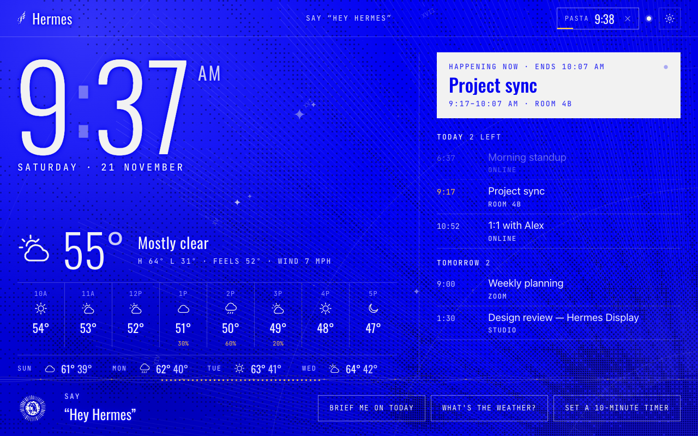
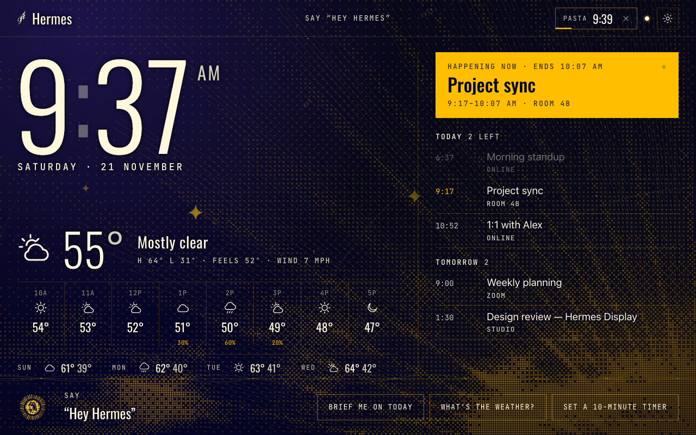
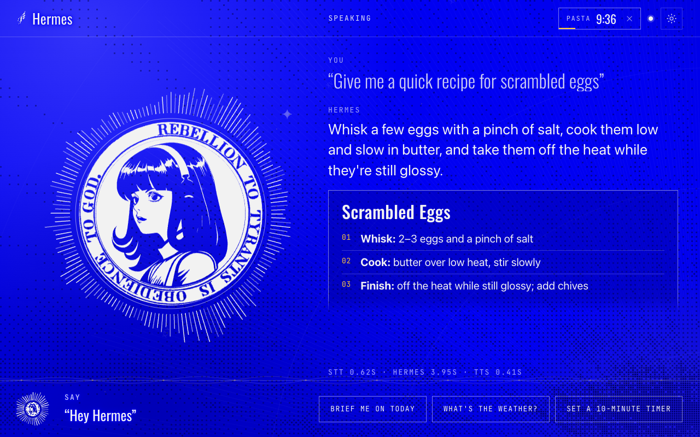
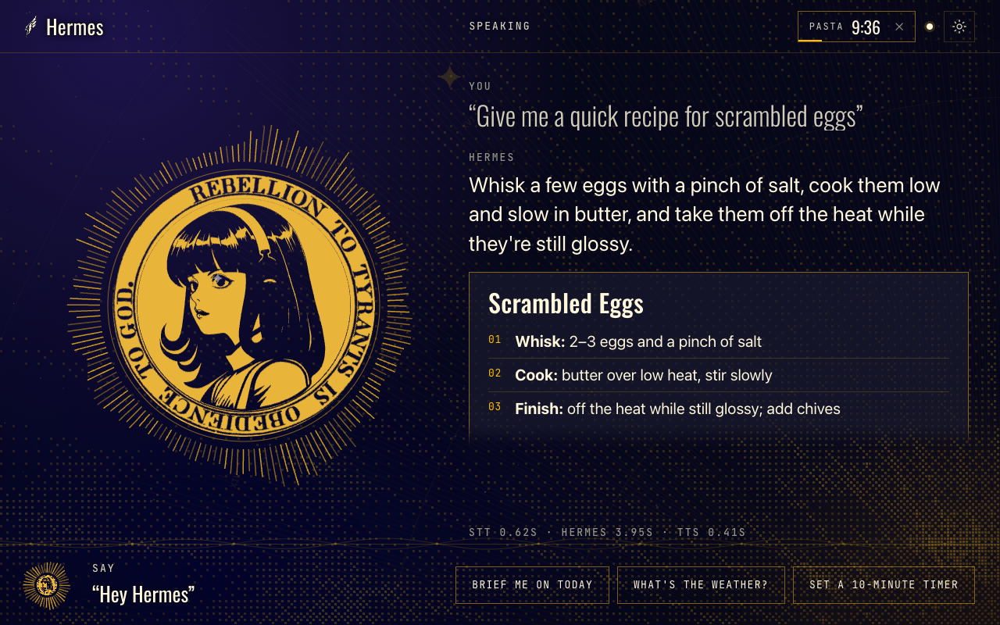

# Hermes Display

**Turn a Meta Portal into an Echo-style smart display for [Hermes Agent](https://github.com/NousResearch/hermes-agent).**

Say "Hey Hermes" and your own Hermes answers out loud, with a card on the screen when there's something worth
seeing. Between questions the Portal is a clock, weather and calendar display.

| | |
|---|---|
|  |  |
|  |  |

- **Wake word on the device.** "Hey Hermes" is detected offline on the Portal. Nothing is sent anywhere until it hears it.
- **Your Hermes, your tools.** Questions go to the Hermes Agent you already run, with its memory, skills and web access.
- **A screen that earns its place.** Spoken answers stay short; lists, recipes and tables show up as a card.
- **Timers, alarms, volume, day/night theme** by voice, handled on the Portal itself.
- **Idle screen** with clock, weather, forecast and (optionally) today's calendar.
- **No accounts, no cloud voice stack, no Home Assistant.** Speech-to-text runs on your own machine.

Nothing on the Portal is removed or modified. You can go back to Meta's home screen with one command.

## What you need

- **A Meta Portal with ADB turned on.** Built and tested on the Portal 10" (1st gen, Android 9). One user reports it
  also runs on a 2nd-gen Portal; I haven't tried that myself. Other Portals are untested: the layout is made for a
  1280×800 screen.
- **Hermes Agent** running on a computer that stays on (a Mac, a Linux box, a home server or a VPS).
- On that same computer: **Python 3.10+** and **ffmpeg**.
- For the one-time install: a **USB-C data cable** and a computer with **adb**
  (`brew install --cask android-platform-tools` on macOS, `sudo apt install adb` on Debian/Ubuntu).

## How it fits together

```
 Meta Portal                                  Your computer or server
┌──────────────────────────┐   your speech   ┌────────────────────────────────────────┐
│ Hermes Display app       │ ───────────────▶│ voice bridge   (server/, port 8650)    │
│  wake word (offline)     │                 │   faster-whisper   speech → text       │
│  mic, speaker, screen    │ ◀───────────────│   Hermes Agent API (port 8642)         │
│  timers and alarms       │  answer + audio │   edge-tts         text → speech       │
└──────────────────────────┘                 └────────────────────────────────────────┘
```

Two pieces to install: the **bridge** (a small Python service next to Hermes) and the **app** (on the Portal).

## Install

About 15 minutes. Run every command from the folder you cloned this repo into.

```bash
git clone https://github.com/mattcrum/hermes-portal-display.git
cd hermes-portal-display
```

### Step 1. Turn on Hermes' API server

On the computer where Hermes Agent runs:

```bash
hermes config set API_SERVER_ENABLED true
hermes config set API_SERVER_KEY "$(openssl rand -hex 32)"
```

Restart the Hermes gateway so it picks this up (`hermes gateway stop && hermes gateway`, or restart its service),
then check it answers:

```bash
curl -s http://127.0.0.1:8642/health
```

More detail: [Hermes API server docs](https://hermes-agent.nousresearch.com/docs/user-guide/features/api-server).

> **Recommended:** limit what a room microphone can do. In `~/.hermes/config.yaml`, give the API server a short
> toolset with no terminal, file, code or browser tools:
>
> ```yaml
> platform_toolsets:
>   api_server: [web, memory, session_search, skills, todo, cronjob]
> ```

### Step 2. Set up the voice bridge

On the same computer:

```bash
./server/setup.sh
```

This installs the Python packages into `server/.venv`, creates `server/.env` with a fresh key for the Portal, and
copies Hermes' API key in. Then:

1. Open `server/.env` and set your town for the weather: `PLACE_NAME`, `WEATHER_LAT`, `WEATHER_LON`, `WEATHER_UNITS`.
2. Start the bridge:

   ```bash
   ./server/run.sh
   ```

   On Linux, run it at boot instead with `./server/setup.sh --systemd`.
3. Check it:

   ```bash
   curl http://localhost:8650/voice/health
   ```

   You should see `{"ok":true,"whisper_loaded":true}`.

`setup.sh` prints the bridge's address on your network, for example `http://192.168.1.50:8650`. You need it in step 4.
If the computer has a firewall, allow incoming connections on port 8650 from your home network.

### Step 3. Turn on ADB on the Portal

1. On the Portal: **Settings → Debug → ADB Enabled**. No Debug option? It arrives with a software update: put the
   Portal on Wi-Fi, install any pending updates, and give it a while. [More](docs/portal.md#connecting-adb)
2. Plug a USB-C **data** cable into the Portal's USB-C port and into your computer.
3. Tap **Allow USB debugging** on the Portal's screen.
4. Check the computer sees it:

   ```bash
   adb devices
   ```

   It should list one device. If the list is empty, see [ADB gotchas](docs/portal.md#connecting-adb).

### Step 4. Install the app

With the Portal plugged in, using the address from step 2:

```bash
./android/install.sh --url http://192.168.1.50:8650
```

The script downloads the latest release, installs it, grants the microphone permission, asks for the Portal key
(print it on the bridge computer with `grep ^PORTAL_VOICE_KEY= server/.env`), and offers to make Hermes the Portal's
home screen.

If the Portal is plugged into the same computer the bridge runs on, skip the typing:

```bash
./android/install.sh --url http://192.168.1.50:8650 --key-from server/.env
```

<details>
<summary>Prefer to do it by hand?</summary>

Download `hermes-display.apk` from the [latest release](https://github.com/mattcrum/hermes-portal-display/releases/latest), then:

```bash
adb install -r hermes-display.apk
adb shell pm grant io.github.mattcrum.hermesdisplay android.permission.RECORD_AUDIO
adb shell am start -n io.github.mattcrum.hermesdisplay/.MainActivity --es base_url "http://192.168.1.50:8650" --es key "YOUR_PORTAL_VOICE_KEY"
adb shell cmd package set-home-activity io.github.mattcrum.hermesdisplay/.MainActivity   # optional: start at boot
```

You can also type the bridge URL and key on the Portal itself: tap the gear in the top-right corner.
</details>

### Step 5. Try it

Make sure the Portal's microphone isn't muted (a crossed-out mic in the status bar means it is), then say:

> "Hey Hermes, what's the weather tomorrow?"
> "Hey Hermes, set a pasta timer for nine minutes."
> "Hey Hermes, give me a recipe for scrambled eggs."

You can also tap the coin in the bottom-left corner instead of saying the wake word.

## Using it

| | |
|---|---|
| Ask something | "Hey Hermes, …" in one breath, or tap the coin and talk |
| Interrupt an answer | Say "Hey Hermes" again, or tap the coin |
| Follow-up | If Hermes ends with a question, the mic re-opens once without the wake word |
| Timers and alarms | "Set a 10 minute timer", "Wake me at 7:30", "Cancel the timers". Stop a ringing one by tapping or saying "stop timer" |
| Volume, theme | "Volume 6", "Night mode", "Back to automatic" |
| New conversation | Gear → **New conversation** (a conversation is also dropped after 10 quiet minutes) |
| Settings | Gear, top right: key, bridge URL, wake phrase, theme, 12/24-hour clock, show or hide the calendar |

At night the theme turns gold-on-ink 30 minutes after sunset, and between 23:00 and 06:00 the idle screen dims to a clock.

## Update, undo, uninstall

```bash
./android/install.sh --url http://192.168.1.50:8650 --key-from server/.env    # upgrade the app to the latest release
git pull && ./server/setup.sh                                                 # upgrade the bridge, then restart it

# Meta's home screen back (the app stays installed):
adb shell cmd package set-home-activity com.facebook.alohaapps.launcher/com.facebook.aloha.app.home.touch.HomeActivity

# Remove the app completely:
adb uninstall io.github.mattcrum.hermesdisplay
```

While Hermes is the home screen, Meta's launcher can't be opened from the Portal. **Gear → Portal settings** still opens
Meta's Settings (to check ADB is on, change Wi-Fi and so on).

## Troubleshooting

| What you see | What to do |
|---|---|
| No **Debug → ADB Enabled** in the Portal's Settings | The option comes with a software update. Connect to Wi-Fi, install pending updates, then wait: it can take a while to show up after updating. [More](docs/portal.md#connecting-adb) |
| `adb devices` is empty or says `unauthorized` | Use a data cable, toggle ADB off and on while plugged in, accept the prompt on the Portal. [More](docs/portal.md#connecting-adb) |
| "Not set up — add the bridge URL in Settings" | Run `./android/install.sh --url …` again, or tap the gear and enter the URL and key |
| "Voice key rejected" | The key on the Portal doesn't match `PORTAL_VOICE_KEY` in `server/.env`. Re-run the install script |
| "Failed to connect", timeouts | The Portal can't reach the bridge. Same Wi-Fi? Bridge running? Firewall open on 8650? `BIND_HOST=0.0.0.0` in `server/.env`? |
| "Server error 502" | The bridge can't reach Hermes, or Hermes rejected its key. Look at the bridge's output (`journalctl -u portal-voice -f` with systemd) and check step 1 |
| "Server error 504" | Hermes took too long. Raise `HERMES_TIMEOUT` in `server/.env` if your model is slow |
| Nothing happens on "Hey Hermes" | Mic muted on the Portal? The top bar should read *Say "Hey Hermes"*. Watch `adb logcat -s PortalVoice:I` while you say it |
| It wakes up when nobody called it | See [wake word tuning](docs/wake-word.md) |
| No calendar | It's optional. See [calendar](docs/bridge.md#calendar-optional) |
| Wrong town or units | Edit `server/.env` and restart the bridge |

## More

- [The bridge](docs/bridge.md): every setting, HTTPS and remote servers, the calendar, the API.
- [The Portal app](docs/portal.md): device notes, ADB gotchas, building from source, logs, the freeze recorder.
- [Wake word](docs/wake-word.md): how the two-stage detector works and how to tune it.
- [Design notes](docs/design.md): the screen, the art, and what the Portal's WebView can and can't afford.

## Privacy

- The wake word runs offline on the Portal ([Vosk](https://alphacephei.com/vosk/)). Audio leaves the Portal only after it
  hears the wake phrase or you tap, and it goes to your bridge and nowhere else.
- Speech-to-text runs on your machine ([faster-whisper](https://github.com/SYSTRAN/faster-whisper)).
- Spoken replies are made with [edge-tts](https://github.com/rany2/edge-tts), which sends the reply text to
  Microsoft's online voice service.
- Weather comes from [Open-Meteo](https://open-meteo.com), which receives the coordinates you set.
- On a home network the Portal talks to the bridge over plain HTTP. If the bridge is reachable from the internet, put
  it behind HTTPS: see [docs/bridge.md](docs/bridge.md#https-and-remote-servers).

## Credits and license

Code: [MIT](LICENSE).

- The Hermes wing mark and the seal artwork (`android/app/src/main/assets/ui/wing.js`, `seal.svg`) belong to
  [Nous Research](https://nousresearch.com) and are included with their OK. They are not covered by the MIT license.
- Fonts: Oswald and JetBrains Mono, under the SIL Open Font License (license files sit next to them).
- Wake word: Vosk and the `vosk-model-small-en-us-0.15` model, Apache 2.0.

This is a personal project. It is not affiliated with or endorsed by Meta or Nous Research.
